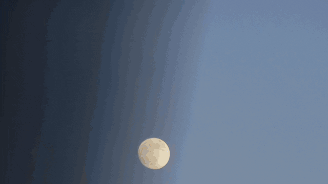
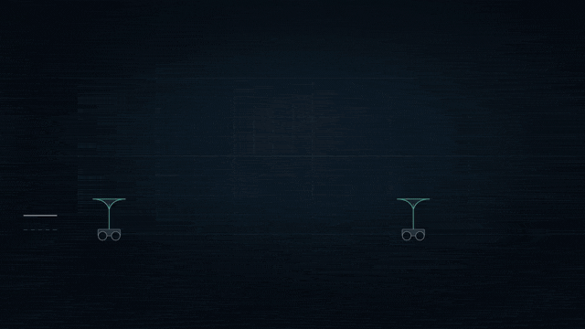
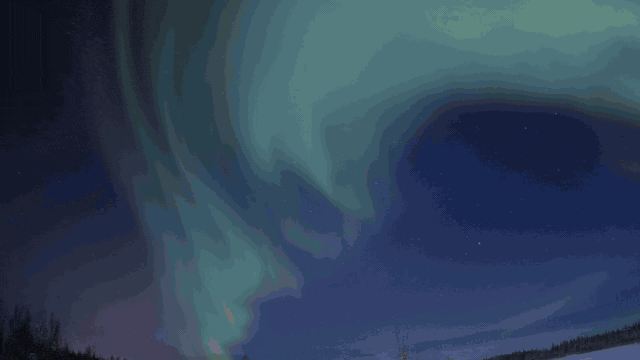
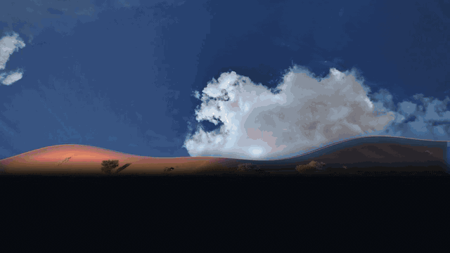

<div align="center">

# MG Studio · MG 动画制作 Skill

**从一句想法、讲解稿或一组数据，做出可播放、可编辑的 MG 动画。**

分层美术 · 逐步讲解 · 旁白与动效同步 · 本地渲染 MP4

**作者**　甲木&阿水

[快速开始](#快速开始) · [制作流程](#制作流程) · [样式设定](#样式设定) · [国产模型实测](#国产模型实测) · [校验与交付](#校验与交付)

</div>

MG Studio 适合制作产品展示、数据播报、流程科普和纸艺短片。素材交代主体、场景和材质，代码负责排版、标注和关键动作。先把每个镜头的构图立住，再决定画面里什么该动、什么时候动。成片附可编辑工程，后续能继续改镜头、数据、画面文字与音轨。

## 快速开始

**手动安装 Skill**

```bash
git clone https://github.com/isjiamu/MG-Studio.git
cd MG-Studio
mkdir -p ~/.codex/skills
cp -R mg-animation-studio ~/.codex/skills/
```

安装后，在支持 Agent Skills 的助手里点名 `$mg-animation-studio`。从一个明确的主题开始，把已有的文稿、数据、参考图或配音一并交给它。

> 用 $mg-animation-studio 做一条 30 秒、16:9 的缓存机制动画。用深色流程蓝图，按两次请求依次展示未命中、回源、回填和直接返回。每句普通话旁白对应一个动作，最后并列两条路径。导出 1080p MP4 和可编辑工程。

本地渲染需要 Node.js 22+、Python 3、FFmpeg（含 `ffprobe`）和 Playwright Chromium。要先跑通已有工程，可按[示例复现指南](examples/README.md)操作。

## 制作流程

| 步骤 | 怎么做 | 产出 |
| --- | --- | --- |
| **1. 定任务** | 明确观众要看懂什么、在哪看、需要多长。核对数据和已有素材，确定画幅、声音和交片时的验收项。 | 简报 |
| **2. 选样式** | 按题材选择一套视觉方向，确定背景、主体、重点色、文字和材质。也可以给参考图或指定品牌色。 | 样式设定 |
| **3. 排分镜与旁白** | 按事件拆镜头。逐句标记旁白、主体动作、结果出现和停留时间。已有配音时，以实际音频时长排镜。 | 分镜与事件时间表 |
| **4. 做素材与动效** | 用正式素材做主画面和关键中间态，检查构图、材质和遮挡。确定后再用 Canvas 合成和排布运动、文字及标注。 | 可编辑工程与关键帧 |
| **5. 渲染与复查** | 检查跳转后的画面一致性、中文可读性和状态变化。导出后核对编码、时长与音轨，再结合成片复查节奏。 | 检查记录与成片 |
| **6. 交付** | 附上 MP4、源工程、分镜、素材来源和复现命令。 | 可播放成片与可修改文件 |

一条实用的分镜写法是「对象 → 动作 → 画面证据」。例如「缓存节点收到回源内容 → 写入副本 → 写入进度到达终点后，再画出返回用户的箭头」。旁白和画面共用这个事件顺序。

### 设计与执行可以分开

设计阶段先确定视觉规则、分镜、素材清单和验收标准。执行阶段按这套约定合成素材、渲染、跑自检，遇到问题就按时间码回到对应镜头修正。一个 Agent 可以完成全流程，也可以把简报、分镜和验收标准交给另一个具备文件和工具访问能力的 Agent 继续执行。

完整规则见 [Skill 入口](mg-animation-studio/SKILL.md)与[分层美术与逐步讲解](mg-animation-studio/references/art-and-flow.md)。

## 样式设定

在提示词里直接写样式名称或参考图。让颜色有明确的角色，例如正文维持稳定对比度，强调色只跟随当前数值、节点或部件。确定风格后，把字重、光向、材质和转场方式记进分镜，方便跨镜头复用。

### MG 动画常用样式

| 样式 | 色彩与材质 | 动效配方 | 适合 |
| --- | --- | --- | --- |
| **编辑感数据** | 米白纸底 `#FAF4E8`，深绿 `#1C654F` 承担重点，砖红 `#AD533A` 标出回落 | 逐项揭示，保留已读数值，最后用基准线或差值收束 | 数据播报、运营复盘 |
| **深色流程蓝图** | 深蓝底 `#122434`，暖橙 `#FAC487` 表示请求，青绿 `#8ADCD0` 表示返回 | 同一对象沿路径移动，逐个高亮节点，片尾复盘全路径 | 技术架构、机制科普 |
| **暖光产品** | 深绿环境配暖金 `#FFDDA4`，用桌面光池和接触阴影交代材质 | 先交代全貌，用局部放大或引线跟随操作，保留部件的运动轴 | 产品特写、功能演示 |
| **分层纸艺** | 暖白纸面 `#FFF0CE`、砖红 `#AC513E` 与独立前景，纸纹跟随裁片 | 保持剪纸的折痕与接点，用遮挡、翻折和视差推进叙事 | 剪纸故事、品牌短片 |

**自定义样式**可以从一句描述开始，例如「暖白纸底、石墨色字、橙色只标当前部件。纸纹贴在部件上，进镜用短推近，结论留两秒」。给参考图时，也可以点明要沿用的是色彩、构图、材质还是动势。

## 国产模型实测

以下四支科普动画用国产模型按 MG Studio 的制作流程完成。每支约 20 秒，原片为 1920×1080，下方动图可循环观看。

### 为什么我们总看到月球的同一面

从肉眼看到的月亮切到地月示意图，用轨道、潮汐隆起和两条周期标尺表现自转逐步趋近公转。



### 地铁列车如何保持间隔

从同一条线上的两趟车切入，叠加列车位置与区段占用，再用简化轨道示意对照不同分区。



### 极光为什么有不同颜色

用极光画面建立现象，再把高度、不同发光色带和波长标签叠在同一纵轴上。



### 沙丘为什么会发出低音

先用波形表现鸣沙的低音，再叠加沙层剖面和声波示意，帮助理解可能的形成机制。



## 校验与交付

MG Studio 把检查分为两个环节。在影片工程目录运行：

| 环节 | 命令 | 检查内容 |
| --- | --- | --- |
| **工程与关键帧** | `npm run verify` · `npm run stills` | 随机跳转、暂停和新页面画面的一致性，已声明的文字边界。另看主体是否被遮挡、数字是否可读、动作中间态是否清楚。 |
| **导出与成片** | `npm run render` · `npm run check` | MP4 的完整解码、尺寸、帧率、时长与音轨。播放检查旁白与画面、停顿和转场。 |

[运行与接口](mg-animation-studio/references/runtime.md)包含配乐、旁白和静音的渲染命令。[验收标准](mg-animation-studio/references/quality.md)列出了数据、机制、手绘和不同画幅的检查重点。

## 仓库说明

| 目录 | 内容 |
| --- | --- |
| [mg-animation-studio/](mg-animation-studio/) | Skill 指令、制作参考、Canvas 起步工程和渲染工具 |
| [examples/](examples/) | 数据、缓存、台灯与剪纸四个可编辑工程，包含简报、分镜、时间轴与材质 |
| `demo/` | 三版对照资料 |

随附 Noto Sans SC 的许可见 [OFL.txt](mg-animation-studio/assets/starter/assets/OFL.txt)。
