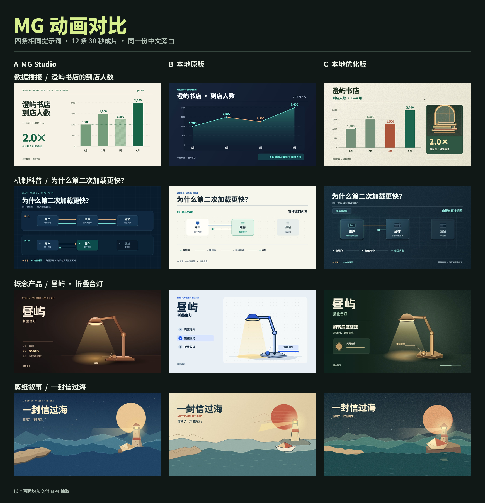

# MG Studio

把产品、数据、技术流程和故事做成可播放、可修改的 MG 动画。先用材质、灯光和前后景建立画面，再让数值、物件和流程节点跟着讲解发生变化。

**作者**　甲木&阿水

[查看三版对比总览](demo/frames/comparison-overview.png) · [打开同步对比页](demo/README.md) · [安装 Skill](#安装-skill) · [复现示例](examples/README.md)

## 四个示例

| 示例 | 看什么 | 成片与工程 |
| --- | --- | --- |
| 澄屿书店的到店人数 | 四个月逐一揭示，突出三月回落和四月翻倍 | [MP4](demo/videos/data-c.mp4) · [分镜](examples/data/STORYBOARD.md) |
| 为什么第二次加载更快？ | 沿请求看缓存未命中、回填和命中，片尾并排复盘两条路径 | [MP4](demo/videos/cache-c.mp4) · [分镜](examples/cache/STORYBOARD.md) |
| 昼屿 · 折叠台灯 | 旋钮转角与桌面亮度同步变化，灯臂沿可见的铰链折叠 | [MP4](demo/videos/lamp-c.mp4) · [分镜](examples/lamp/STORYBOARD.md) |
| 一封信过海 | 信纸沿同一轮廓折成船，穿过分层海浪，靠岸后灯塔亮起 | [MP4](demo/videos/paper-c.mp4) · [分镜](examples/paper/STORYBOARD.md) |

每题使用同一条提示词，制作了 A、B、C 三版。公开对比页可以同步播放三版，跳转到指定动作，并按原旁白时间显示字幕。当前 Skill 和可渲染工程对应 **C 本地优化版**。全部样片为 30 秒、1080p、24 fps。

[](demo/README.md)

## 它怎么工作

- **先做主体和中间态。** 在草图阶段就决定哪些层会移动、遮挡或改变亮度，检查有素材的主画面和最难解释的中间状态。
- **把事件写到同一条时间轴。** 让旁白的入点、关键动作和结果停留各有位置。数据和流程的精确标签由代码绘制，跟着节点或零件走。
- **在本地渲染并复查。** Canvas 按时间计算每一帧。Playwright 抽取静帧并检查随机跳转，FFmpeg 导出和校验 MP4。

## 安装 Skill

拉取仓库。首次安装到 Codex 时，将 `mg-animation-studio/` 整个目录复制过去。

```bash
git clone https://github.com/isjiamu/MG-Studio.git
cd MG-Studio
mkdir -p ~/.codex/skills
cp -R mg-animation-studio ~/.codex/skills/
```

在助手中点名 `$mg-animation-studio`，给一句目标、画幅、时长和声音需求即可。例如：

> 用 $mg-animation-studio 做一条 30 秒的 MG 动画。用两次读取讲清缓存未命中、回填和命中，保留一眼能看懂的路径与结果。导出 1080p MP4，附分镜和可编辑工程。

工程渲染需要 Node.js 22+、Python 3、FFmpeg（含 `ffprobe`）和 Playwright Chromium。可以先从[可渲染示例](examples/README.md)跑一遍，或直接查看 [Skill 入口](mg-animation-studio/SKILL.md)。

## 仓库说明

| 目录 | 内容 |
| --- | --- |
| [mg-animation-studio/](mg-animation-studio/) | Skill 指令、制作参考、本地渲染模板和验收工具 |
| [examples/](examples/) | 四个 C 版案例的简报、分镜、材质、时间轴与绘制源码 |
| [demo/](demo/) | 三版关键帧、12 条公开样片和同步播放页 |

示例中的书店、台灯和数据为演示设定。公开样片使用画面和同步字幕，示例也可以重新混入自己的旁白。随附 Noto Sans SC 的许可见 [OFL.txt](mg-animation-studio/assets/starter/assets/OFL.txt)。
