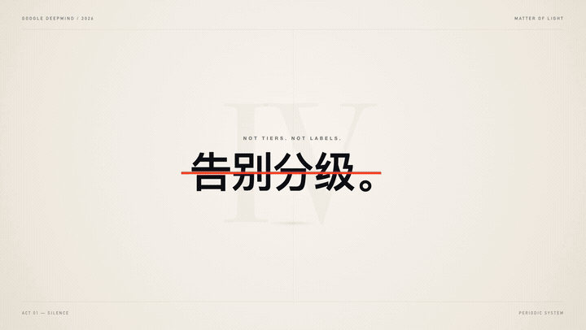
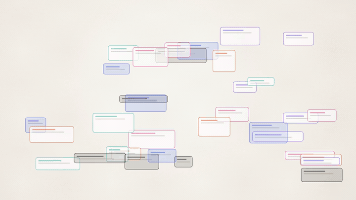
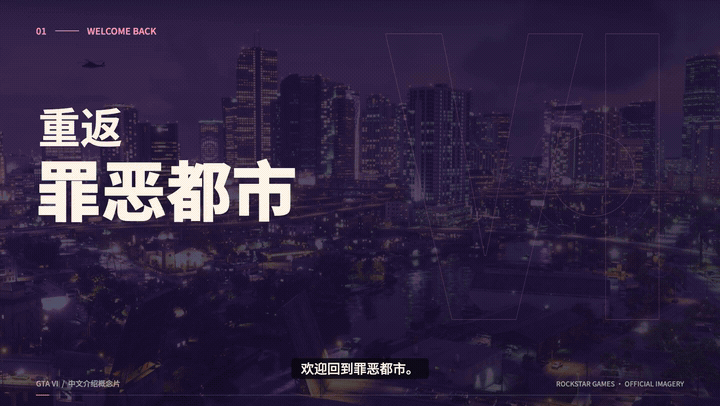
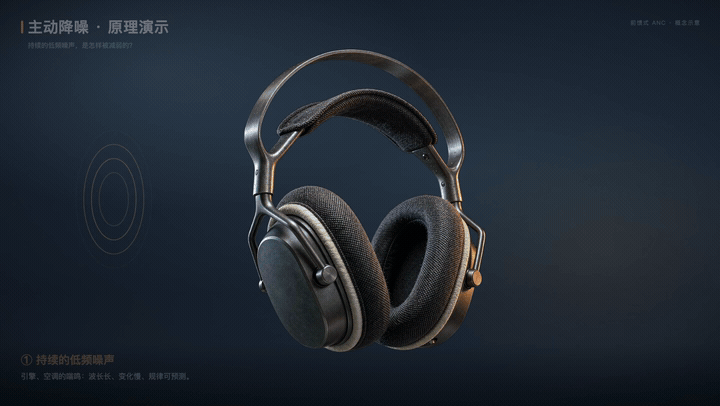

<div align="center">

# MG Studio · MG 动画制作 Skill

**从一句想法、讲解稿或一组数据，做出有导演质感、可编辑、可复现的 MG 动画。**

宏观美学经验 · 审美与精确路由 · Canvas / DOM / Three.js WebGL · 声画同步 · 本地渲染 MP4

**版本**　0.2　·　**作者**　甲木&阿水

[高水准范例](#高水准范例) · [快速开始](#快速开始) · [设计理念与路由](#设计理念与路由) · [制作流程](#制作流程) · [校验与交付](#校验与交付)

</div>

MG Studio 不把审美锁进固定模板，也不规定某个行业必须套用某种配色或版式。它用**路由**明确审美与精确的取舍，用**宏观创作心法**指导世界观、空间光影、排印、运动性格与声音编排，并开放 **Canvas 2D / DOM+SVG / GPU WebGL (Three.js)** 与定制声景工具链。新作品默认从空白入口起步；所有成片均交付可编辑工程与真实 MP4。

## 高水准范例

以下四支可运行范例覆盖 **4 种截然不同的视觉世界、题材类型与技术媒介**，均可通过 `init_project.py --demo <name>` 一键初始化完整可编辑工程并本地渲染。

### 1. `atelier` · MATTER OF LIGHT — 3D 雕塑 × 编辑排印（28s · 60fps · GPU WebGL2）

Three.js 实时 PBR 清漆/虹彩材质与自定义 GLSL 着色器（液态铬、黑钻、发光玻璃结、色散棱镜），夹在前后两层瑞士风格排印之间，配合 124 BPM 原创电子配乐与 35mm 微颗粒。



[查看关键帧总览](demo/frames/atelier.jpg) · 复现：`python3 mg-animation-studio/scripts/init_project.py ./demo-atelier --demo atelier`

---

### 2. `industrial` · LESS, BUT BETTER — 纯 Canvas 2D 精密工业设计（22s · 60fps）

零额外图像或 3D 依赖，纯 HTML5 Canvas 2D 绘制日光陶瓷白与拉丝阳极氧化铝质感、325 孔声学矩阵波纹、双旋钮示波器与 VU 表、欠阻尼机械卡位弹簧，以及声画咬合的物理 ASMR 声景。



[查看关键帧总览](demo/frames/industrial.jpg) · 复现：`python3 mg-animation-studio/scripts/init_project.py ./demo-industrial --demo industrial`

---

### 3. `gta6` · GTA VI 阳光之下 — 60s 预告片级多图叙事与旁白混音（60s · 30fps）

8 镜电影化节奏、多图分层裁切（`lib/layers.js`）、斜切转场、定时中文字幕、120 BPM 合成器浪潮配乐（`audio/compose.py`）与中文旁白自动压低（ducking）混音全链路示范。



[查看关键帧总览](demo/frames/gta6.jpg) · 复现：`python3 mg-animation-studio/scripts/init_project.py ./demo-gta6 --demo gta6`

---

### 4. `anc` · 主动降噪原理演示 — 剖面素材 × 精确声学波形（15s · 30fps · DOM+SVG）

工作室剖面渲染素材与代码精确驱动的同轴相消正弦波形融合，整机到内部麦克风、DSP、扬声器的连续推近拆解，兼具工业美学与物理清晰度。



[查看关键帧总览](demo/frames/anc.jpg) · 复现：`python3 mg-animation-studio/scripts/init_project.py ./demo-anc --demo anc`

## 快速开始

**安装 Skill**

```bash
git clone https://github.com/isjiamu/MG-Studio.git
cd MG-Studio
mkdir -p ~/.codex/skills
cp -R mg-animation-studio ~/.codex/skills/
```

安装后，在支持 Agent Skills 的工具里调用 `$mg-animation-studio`（或直接指向 `mg-animation-studio/SKILL.md`）。

> 用 $mg-animation-studio 把这个想法做成一支 25 秒、1080p 的 MG 动画。根据题材自己建立合适的视觉世界与最匹配的技术栈，先出全分辨率风格帧审片，再渲染带原创配乐的 MP4 与可编辑工程。

**运行任一内置范例**

```bash
# 查看全部范例
python3 mg-animation-studio/scripts/init_project.py --list-demos

# 初始化并渲染（以 industrial 为例；atelier 含 three 依赖请改用 npm install）
python3 mg-animation-studio/scripts/init_project.py ./my-industrial --demo industrial
cd ./my-industrial
npm ci && npx playwright install chromium
npm run score     # 有声范例生成配乐（anc 为静音可跳过）
npm run verify    # 确定性时间轴校验
npm run stills    # 生成关键帧与接触表
npm run render && npm run check
```

本地渲染需要 Node.js 22+、Python 3（含 NumPy 时可运行 `atelier` / `industrial` / `gta6` 的定制声景脚本）、FFmpeg（含 `ffprobe`）和 Playwright Chromium。

## 设计理念与路由

- **不约束审美，传授宏观经验**：完整见 [宏观创作心法](mg-animation-studio/references/craft-philosophy.md)——先立题材的视觉世界与物质感，用注意力节奏、空间光影、排印造型、运动性格与声画同步把画面推到作品级完成度。
- **审美与精确路由**：大多数时候二者并不冲突，路由只在真发生取舍时生效（详见 [路由指南](mg-animation-studio/references/routing.md)）：
  - `aesthetic`（审美与感染力优先）：品牌片、发布会、设计宣言、预告与艺术表达。事实不编造，文案精炼，画面与情绪拥有最高空间。
  - `balanced`（默认，审美与准确并重）：知识科普、产品拆解、财经解读、技术架构。数据与因果严格准确，同时把材质、空间和节奏做到高水准。
  - `precise`（精确与读数优先）：教学图表、可测量数据播报、工程规范。刻度、基线与比例严格准确，在清晰结构内追求出版物级质感。
- **开放技术栈**：默认 `capture:"canvas"` 支持纯 Canvas 2D 及内置 `lib/look.js` / `lib/camera.js`；设 `capture:"dom"` 可自由使用 HTML / SVG / CSS 滤镜混合；加 `"gpu": true` 可开启硬件 WebGL（如 Three.js PBR + GLSL 着色器）；`film.json.audio.script` 与 `audio.voice` 支持定制声景与旁白自动压低混音。

## 制作流程

| 步骤 | 做什么 | 产出 |
| --- | --- | --- |
| **1. 简报与路由** | 明确核心信息、受众、表达重心路由，区分固定事实与自由创作区；探测本机可用媒介能力（GPU / 字体 / 素材 / 声音）。 | 简报与技术选型 |
| **2. 分镜与风格帧** | 拆解镜头与时间节奏，先将 2–3 张代表画面（主视觉 + 最难中间态）直接做到成片质感并全分辨率审片。 | 分镜与风格帧 |
| **3. 实现与声画同步** | 以确定性 `seek(t)` 驱动全部画面，同步编排原创配乐、定制声景脚本或旁白压低混音。 | 可编辑工程 |
| **4. 视觉评审与校验** | 结合全分辨率审片与自动化检测（`verify` + `check`），打磨最影响整体观感的 1–3 处后交付。 | MP4、源工程与复现记录 |

完整指令见 [SKILL.md](mg-animation-studio/SKILL.md) 与 [范例导览](mg-animation-studio/references/demos.md)。

## 校验与交付

| 环节 | 命令 | 检查内容 |
| --- | --- | --- |
| **确定性与关键帧** | `npm run verify` · `npm run stills` | 正序/逆序/乱序跳转、静置停留与新页面画面一致性；输出接触表供全分辨率导演审片。 |
| **导出与实片核验** | `npm run render` · `npm run check` | H.264 完整解码、分辨率、帧率、时长、静音/有声意图、LUFS 与真峰值检测。 |

声音、GPU 渲染与多字体配置见 [运行与接口](mg-animation-studio/references/runtime.md)；验收与修正规范见 [验收标准](mg-animation-studio/references/quality.md)。

## 仓库说明

| 目录 | 内容 |
| --- | --- |
| [mg-animation-studio/](mg-animation-studio/) | Skill 正文、宏观美学与路由参考、空白起步工程、工具箱（`look.js` / `camera.js` / `motion.js` / `layers.js`）、渲染校验脚本与 4 支可运行范例（`assets/demos/`） |
| [demo/](demo/) | 4 支范例的动图预览、关键帧接触表与本地浏览页（`demo/index.html`） |

随附 Noto Sans SC 字体许可见 [OFL.txt](mg-animation-studio/assets/starter/assets/OFL.txt)。
